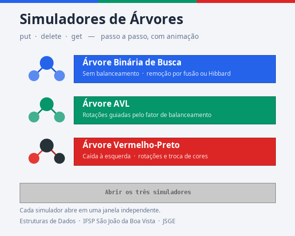
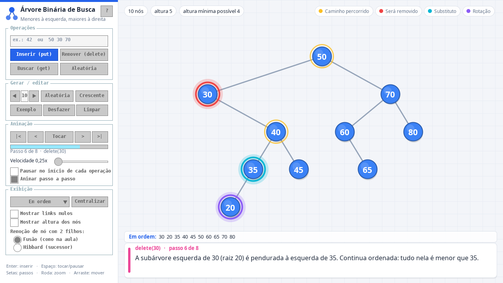
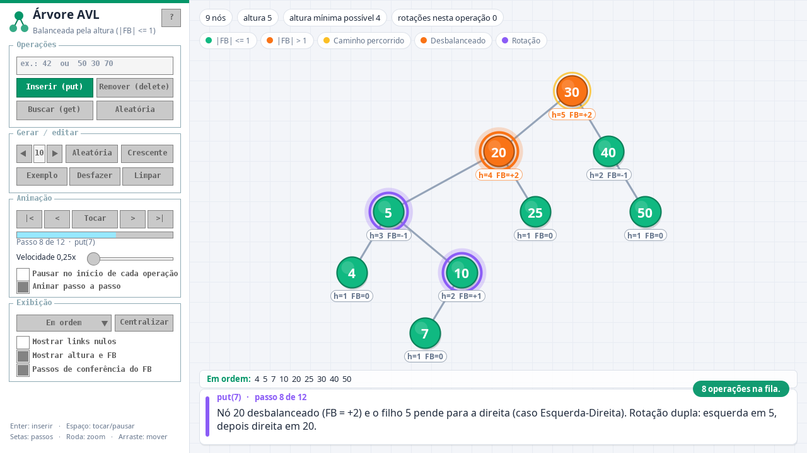
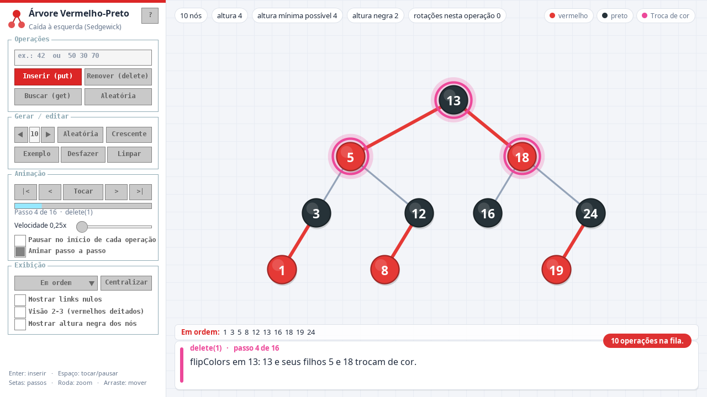
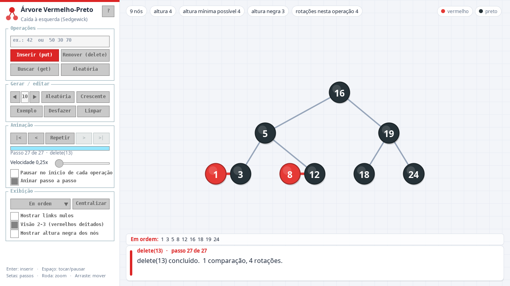

# Simuladores de Árvores (JSGE)

Projeto de Estruturas de Dados — IFSP São João da Boa Vista.
Simulador gráfico, com animação passo a passo, de três árvores binárias:

- **Árvore Binária de Busca** (BST)
- **Árvore AVL**
- **Árvore Vermelho-Preto** (caída à esquerda, do Sedgewick)

Cada simulador roda em uma **janela independente** e mostra as operações
**put** (inserir) e **delete** (remover) — e também **get** (buscar).
A interação é feita com os componentes **ImGUI** da JSGE.



| BST — remoção por fusão | AVL — rotação dupla |
|---|---|
|  |  |

| Vermelho-Preto — flipColors | Vermelho-Preto — visão 2-3 |
|---|---|
|  |  |

---

## Como rodar

**Precisa de:** JDK 17 ou mais novo (a JSGE 1.9.1 é compilada para Java 17).
As bibliotecas da JSGE já estão dentro do projeto, na pasta `lib/`.

**No NetBeans**
1. *Arquivo → Abrir Projeto* → escolha a pasta `SimuladoresArvores`.
2. *Executar Projeto* (F6) abre o **menu** (`arvores.Main`).
3. Cada simulador também roda sozinho: botão direito em
   `SimuladorBST.java`, `SimuladorAVL.java` ou `SimuladorVermelhoPreto.java`
   → *Executar Arquivo* (Shift+F6).

**Sem NetBeans** (pasta `dist/`, gerada pelo *Limpar e Construir*):

```
java -jar dist/SimuladoresArvores.jar          # abre o menu
java -jar dist/SimuladoresArvores.jar avl      # abre direto um simulador (bst, avl ou vp)
```

**No laboratório:** copie a pasta inteira do projeto (pendrive / GitHub).
Não depende de nada instalado além do JDK e do NetBeans.

---

## O que dá para fazer

| | BST | AVL | Vermelho-Preto |
|---|:-:|:-:|:-:|
| put / delete / get animados, passo a passo | ✔ | ✔ | ✔ |
| Texto explicando cada passo (com o nome do método da aula) | ✔ | ✔ | ✔ |
| Destaque do caminho, nó comparado, substituto, rotação... | ✔ | ✔ | ✔ |
| Remoção com 2 filhos: **fusão** (como na aula) ou **Hibbard** | ✔ | | |
| Altura e **fator de balanceamento** em cada nó, nó laranja se \|FB\| > 1 | | ✔ | |
| Cores dos nós e **links vermelhos**; **visão 2-3** | | | ✔ |
| Percursos (em ordem, pré, pós, em nível), links nulos, altura mínima | ✔ | ✔ | ✔ |
| Desfazer, gerar árvore aleatória/crescente, exemplo pronto | ✔ | ✔ | ✔ |

**Controles**
- Campo de chaves: uma chave (`42`) ou várias (`50 30 70`); **Enter** insere.
- Clicar em um nó copia a chave dele para o campo.
- `|<` `<` `>` `>|` navegam pelos passos; **Pausar / Tocar / Repetir**; controle de velocidade.
- **Pausar no início de cada operação**: bom para explicar com calma.
- **Animar passo a passo** desligado: aplica as operações direto.
- Roda do mouse = zoom; arrastar o fundo = mover; *Centralizar* volta ao normal.
- Botão **?** abre a ajuda de cada simulador.

---

## Como o código está organizado

```
src/arvores/
├── Main.java                       ponto de entrada: escolhe o modo gráfico e abre o menu
├── modelo/                         as árvores (sem nada de desenho)
│   ├── No.java                     nó: id, chave, esquerda, direita, altura, vermelho
│   ├── ArvoreAnimada.java          base: grava os passos, busca (get), religar, desfazer
│   ├── ArvoreBinariaBusca.java     put / delete (fusão e Hibbard)
│   ├── ArvoreAVL.java              put / delete / balance / rotações
│   ├── ArvoreVermelhoPreto.java    put / delete / deleteMin / moveRedLeft / moveRedRight / flipColors
│   ├── Passo.java, NoFoto.java     a "foto" da árvore em cada passo
│   └── Destaque, TipoPasso, Percurso
└── visual/                         a parte da JSGE
    ├── Menu.java                   menu: abre cada simulador em uma janela
    ├── SimuladorArvore.java        base (EngineFrame): ImGUI, animação, câmera, desenho
    ├── CacheImagens.java           guarda nós/painéis já desenhados (desempenho)
    ├── SimuladorBST.java           cores, opções e textos de cada árvore
    ├── SimuladorAVL.java
    ├── SimuladorVermelhoPreto.java
    └── Janelas.java                cada janela fecha sozinha; o programa termina na última
```

### A ideia principal (para explicar na apresentação)

1. **Os algoritmos são os da aula.** `put` e `delete` seguem a biblioteca
   `aesd` (BinarySearchTree, AVLTree e RedBlackTree), com a mesma recursão.
   A diferença é que, nos pontos importantes, o código chama `passo(...)`.
2. **`passo(...)` tira uma foto da árvore** (`NoFoto`) e guarda um texto
   explicando o que aconteceu e quais nós destacar. É a mesma ideia do
   simulador de ordenação da aula, que copiava o vetor a cada passo.
3. **O simulador anima de uma foto para a próxima.** Cada nó tem um `id`
   que nunca muda; se o nó mudou de lugar (rotação, remoção), ele desliza
   da posição antiga para a nova. Nó novo nasce no pai; nó removido some.
4. **`religar(antigo, novo)`.** Na recursão, o pai só recebe a subárvore nova
   quando a chamada volta (`no.esquerda = put(...)`). Para a foto tirada
   logo depois de uma rotação não mostrar o nó "solto", o `religar` já liga
   a nova subárvore no pai; quando a recursão volta, a atribuição repete o
   mesmo valor e nada muda.
5. **Desenho:** x = posição do nó em ordem, y = nível. Assim nenhum nó fica
   em cima de outro, qualquer que seja o formato da árvore.

### Componentes ImGUI usados
`GuiTextField`, `GuiButton`, `GuiSpinner`, `GuiSlider`, `GuiProgressBar`,
`GuiCheckBox`, `GuiRadioButton` + `GuiButtonGroup`, `GuiDropdownList`,
`GuiGroup`, `GuiLabel`, `GuiToolTip` e `GuiConfirmDialog`.

---

## Como foi testado

- **Comparação com a biblioteca da aula:** 28.455 operações aleatórias
  (put/delete/get) feitas ao mesmo tempo nas árvores do projeto e nas da
  biblioteca `aesd`. Depois de cada operação, a estrutura (pré-ordem com
  L/R), as **alturas** da AVL e as **cores** da Vermelho-Preto ficaram
  **idênticas** às da biblioteca.
- **Regras conferidas a cada operação:** |FB| ≤ 1 na AVL; na Vermelho-Preto,
  sem vermelho à direita, sem dois vermelhos seguidos, mesma altura negra.
- **Fotos:** em todos os ~560 mil passos gravados, nenhum nó repetido e
  nenhuma subárvore perdida.
- **Interface:** teste de estresse com ~1000 cliques aleatórios nos três
  simuladores abertos ao mesmo tempo, sem nenhum erro.

### Desempenho

A primeira versão travava no Linux. Medido nesta máquina (i5-1035G1):

| | quadros por segundo | tempo de desenho por quadro | CPU do Xorg |
|---|--:|--:|--:|
| antes, 1 simulador | 9 | 115 ms | 125% |
| antes, 3 simuladores abertos | 2,7 em cada | — | 121% |
| **agora, 1 simulador** | **62** | **4 ms** | 15% |
| **agora, 3 simuladores + menu** (40 nós cada) | **~48 em cada** | — | 22% |

Duas causas e duas correções:
1. **Modo gráfico do Java no Linux.** O padrão (XRender) manda cada forma com
   antialiasing para o servidor gráfico desenhar. `Janelas.configurarGraficos()`
   troca para o modo X11 com o buffer na memória do Java. Detalhe: a
   `EngineFrame` liga o sistema gráfico assim que é carregada, por isso o
   `Main` não é uma janela e configura isso antes de tudo (no NetBeans, as
   mesmas opções estão no `run.jvmargs` do projeto).
2. **Formas caras redesenhadas a cada quadro.** Cada nó custava ~140 µs
   (sombra + corpo + brilho + borda); a sombra da caixa de descrição, 514 µs.
   Agora o nó é desenhado uma vez numa imagem pequena e depois só copiado
   (`CacheImagens`); cabeçalho, barra de percurso e caixa de descrição só são
   redesenhados quando o conteúdo muda. O visual é o mesmo.

Altura com o botão **Crescente** (10, 20, 30...):

| N | BST | AVL | Vermelho-Preto | mínima possível |
|--:|--:|--:|--:|--:|
| 15 | 15 | 4 | 4 | 4 |
| 31 | 31 | 5 | 5 | 5 |
| 40 | 40 | 6 | 6 | 6 |

---

## Roteiro de apresentação (≈ 8 minutos)

1. **Menu → "Abrir os três simuladores"** — mostra que são janelas independentes.
2. **BST** (velocidade ~2x)
   - *Exemplo* → mostra o caminho de cada inserção (amarelo) e o texto embaixo.
   - Digite `45` → *Buscar*.
   - Digite `30` → *Remover*: dois filhos → **fusão** (a subárvore 20 vai para o 35).
   - *Desfazer* → marque **Hibbard** → *Remover* `30` de novo: agora o 35 sobe.
   - *Crescente* com N = 15 → **altura 15**: a BST virou lista.
3. **AVL**
   - *Exemplo* → passa pelos 4 casos de rotação. Pare (*Pausar*) em um nó laranja
     e mostre `h` e `FB` embaixo de cada nó.
   - *Crescente* com N = 15 → **altura 4** (contra 15 da BST).
4. **Vermelho-Preto**
   - *Exemplo* (S E A R C H X M P L do livro) → rotações e *flipColors* na volta do put.
   - Marque **Visão 2-3**: os pares vermelhos viram nós-3.
   - Marque **Pausar no início de cada operação**, remova `13` e avance com `>`
     explicando: raiz pintada de vermelho → *moveRedRight* → cópia do sucessor →
     *deleteMin* → *balance* na subida.
5. Fechamento: a mesma sequência crescente deu altura 15 / 4 / 4.

### Perguntas que podem aparecer
- **Por que a cor fica no nó?** A cor é do link que chega no nó; como cada nó
  tem um único pai, guardar no nó é o mesmo que guardar no link.
- **Por que o delete da Vermelho-Preto pinta a raiz de vermelho?** Para a
  descida nunca parar em um nó-2; no fim a raiz volta a ser preta.
- **Fusão x Hibbard?** As duas mantêm a ordem; a fusão (da biblioteca) pode
  deixar a árvore mais alta, o Hibbard costuma manter a altura menor.
- **Altura usada?** Folha = 1 e link nulo = 0, como na `AVLTree` da aula.

---

Autor: Matheus Ubinha Furlan · JSGE 1.9.1 (Prof. Dr. David Buzatto)
